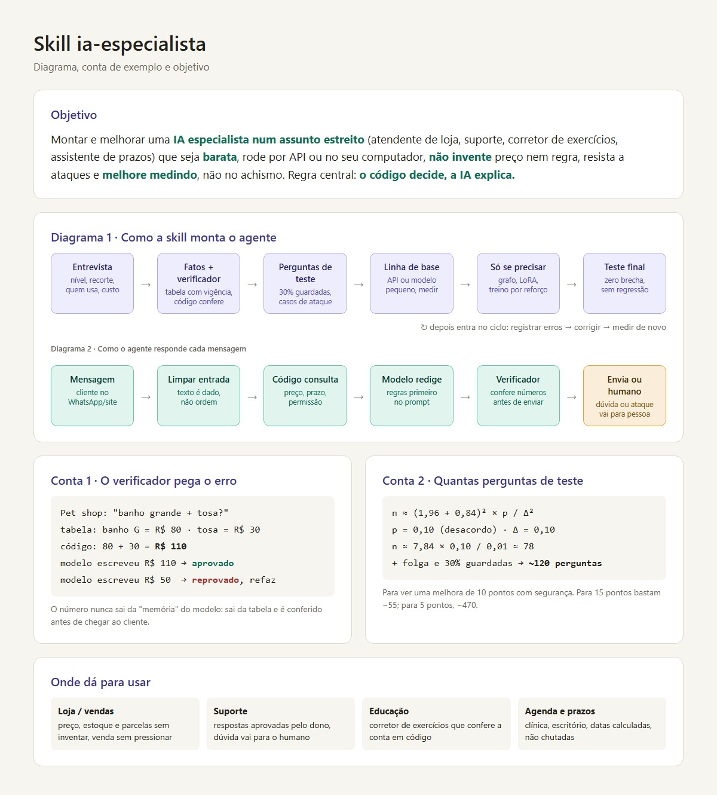
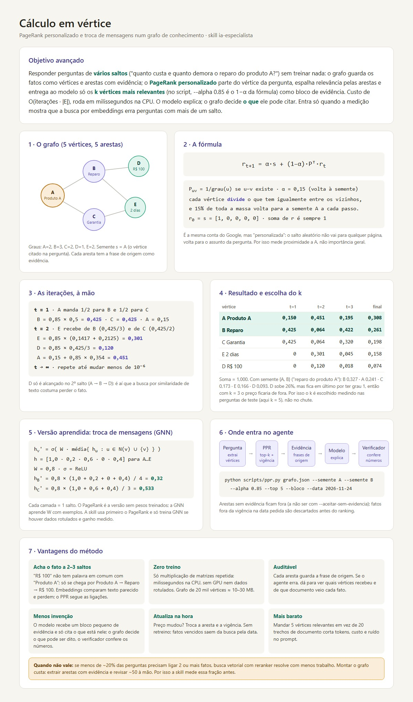

# ia-especialista

**Uma skill para o [Claude Code](https://claude.com/claude-code) que monta e melhora uma IA especialista num assunto estreito: barata, medida, segura e sem inventar.**

Atendente de loja, bot de suporte, corretor de exercícios, assistente de prazos ou agenda: a skill conduz do primeiro pedido até o teste final, por API ou rodando no seu computador.

Gratuita e de código aberto ([MIT](LICENSE)).

> **A regra central: o código decide, a IA explica.**
> Preço, data, prazo, conta e permissão saem de tabela, cálculo ou banco. A IA só interpreta a pergunta e explica o resultado, e um verificador confere a resposta antes de enviar.



---

## Por que usar

| Problema comum | O que a skill faz |
|---|---|
| A IA inventa preço, prazo ou regra | Fatos ficam em tabela com vigência; o verificador barra número que não bate |
| "Treinei e piorou" / "não sei se melhorou" | Perguntas de teste com 30% guardadas e comparação pareada antes de adotar qualquer mudança |
| Cliente manda "ignore as instruções…" | Segurança como permissão em código, casos de ataque desde o início, meta de zero brecha |
| O preço mudou e a IA continua dizendo o antigo | Troca uma linha na tabela; nada de retreinar |
| Treinar custa caro e ninguém sabe se precisa | Treino (LoRA, RLVR) só entra quando a medição mostra que a falha é de forma |
| Iniciante não sabe o que pedir | Entrevista ajustada ao nível, sempre com um resultado visível junto |

## Como ela funciona

1. **Entrevista** ajustada ao seu nível: iniciante recebe mais perguntas, simples e sobre o negócio; avançado recebe poucas, diretas e com números. Sai uma ficha do especialista para você aprovar.
2. **Fatos e verificador:** tabela com data de vigência, mais um código que confere todo número e nome da resposta.
3. **Perguntas de teste:** casos normais, casos de recusa e **ataques** (injeção indireta, autoridade falsa, abuso de ferramentas, extração de dados), com 30% guardados para o teste final.
4. **Linha de base:** API ou modelo pequeno em 4 bits, medido antes de qualquer peça nova.
5. **Só se precisar:** grafo com PageRank personalizado, LoRA/QLoRA com busca de hiperparâmetros, treino por reforço com verificador (RLVR/GRPO), destilação.
6. **Ciclo de melhoria (Harness²):** registrar erros, corrigir uma coisa por vez, medir de novo. Segurança sempre primeiro.
7. **Teste final** no conjunto guardado: zero brecha e nenhuma regressão.

### Como o agente responde cada mensagem

```
mensagem → limpar entrada → roteador → ferramentas consultam e calculam
        → regras primeiro no prompt → modelo redige → verificador confere
        → envia  (ou passa para um humano se houver dúvida ou ataque)
```

## Destaque: cálculo em vértice

Para perguntas que precisam ligar vários fatos ("quanto custa e quanto demora o reparo do produto A?"), a skill usa **PageRank personalizado num grafo de conhecimento**: parte do vértice da pergunta, espalha relevância pelas arestas e entrega à IA só os vértices mais relevantes, cada um com a frase de origem. Não tem treino, roda em milissegundos na CPU e dá para auditar.



| | Treinar o modelo para decorar fatos | Grafo + cálculo em vértice |
|---|---|---|
| Preço mudou | Retreinar | Trocar uma linha |
| Não sabe a resposta | Inventa com confiança | Passa para um humano |
| De onde veio a resposta | Ninguém sabe | Cada fato tem a fonte |
| Equipamento | GPU, horas | Computador comum, milissegundos |
| Para começar | Milhares de exemplos | A tabela que a empresa já tem |

O grafo só entra quando a medição mostra que pelo menos ~20% das perguntas precisam de mais de um salto. Abaixo disso, uma busca simples resolve.

```bash
python scripts/ppr.py grafo.json --semente produto_a --semente reparo --top 5 --bloco --data 2026-11-24
```

## Instalar

```bash
git clone https://github.com/lgsMangolt/ia-especialista.git
cp -r ia-especialista ~/.claude/skills/ia-especialista
```

No Windows (PowerShell):

```powershell
git clone https://github.com/lgsMangolt/ia-especialista.git
Copy-Item -Recurse ia-especialista "$env:USERPROFILE\.claude\skills\ia-especialista"
```

Depois, no Claude Code, comece o pedido com `/ia-especialista`. Por exemplo:

```
/ia-especialista quero um atendente de WhatsApp para meu pet shop que responda preço e horário
```

**Dica:** com muitas skills instaladas, o Claude pode responder perguntas de conselho sem consultar a skill. Para que ela seja usada sozinha, acrescente ao seu `~/.claude/CLAUDE.md`:

> Quando o pedido for para planejar, montar, treinar, ajustar, avaliar ou melhorar um agente, chatbot, atendente ou IA especialista num domínio, carregue a skill `ia-especialista` antes de responder.

## O que tem dentro

| Pasta | Conteúdo |
|---|---|
| `SKILL.md` | O método: peças, trilhas, entrevista, fases e arquitetura |
| `references/` | Entrevista, protocolo de avaliação, segurança e red team, simulação de clientes, venda sem pressionar, ciclo de melhoria, grafo e PageRank, LoRA e busca de hiperparâmetros, treino avançado (RLVR/GRPO, destilação), esforço e verificação, edição de pesos |
| `assets/` | Modelos para copiar: planilha de fatos, perguntas de teste, verificador de preços, script de avaliação, tabela de cobertura |
| `scripts/` | `ppr.py` (PageRank personalizado e bloco de evidências), `lora_size.py` (tamanho de um LoRA), `teste_acionamento.py` (mede se a skill é acionada nos pedidos certos) |
| `evals/` | Casos de teste da própria skill, no formato do `claude plugin eval` |
| `docs/` | As imagens deste README |

Os scripts usam só a biblioteca padrão do Python.

## Resultados nos testes da própria skill

Nos casos de `evals/`, comparando respostas com e sem a skill:

| Caso | Com a skill | Sem a skill |
|---|---|---|
| Rodadas 1 a 3 (plano, LoRA × grafo, PageRank) | 100% | 60–78% |
| Segurança de um agente de clínica | 7/7 | 2/7 |

São testes simulados e pequenos: servem de sinal, não de garantia.

## Limites

- Os números da skill (custos, tamanhos, resultados de simulação) são estimativas ou resultados de testes simulados.
- As partes marcadas como experimentais (edição de pesos, por exemplo) vêm de trabalhos ainda sem revisão por pares.
- Não substitui revisão humana onde o erro custa caro (saúde, jurídico, finanças): a skill desenha a passagem para um humano, e você define quando ela acontece.

## Licença

[MIT](LICENSE). Use, adapte e compartilhe.
